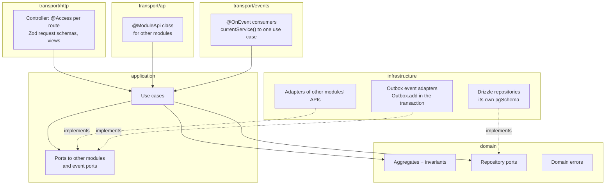

# Architecture overview

## Goals

1. One deployable that is as easy to run as a monolith and as easy to split as
   microservices: modules with hard boundaries inside one process (ADR-0002).
2. Modules that all look the same inside, so any engineer (or AI agent) can work on any
   of them.
3. Correctness by construction: invariants in the database, typed module APIs, one error
   model, no silent fallbacks.
4. A shared platform kit instead of copy-paste, with a module template that is compiled
   and tested on every run.
5. Fast local feedback: the whole system runs on a laptop without containers.

## Containers

```mermaid
flowchart LR
  idp([OIDC provider\nlocally: dev-idp]) -. "access token" .-> client([Client / frontend])
  client -- "HTTPS REST + Bearer token\nproblem+json" --> api
  subgraph api [apps/api: one process]
    direction TB
    guard[AuthGuard\n@Access per route]
    users[users module]
    houses[houses module]
    bookings[bookings module]
    disp[EventDispatcher]
    guard -- "IdentityResolver" --> users
    houses -- "UsersApi.stillExists" --> users
    bookings -- "UsersApi.stillExists" --> users
    bookings -- "HousesApi.findHouse" --> houses
    disp -. "UserDeletedEvent" .-> houses
    disp -. "UserDeletedEvent, HouseDeletedEvent" .-> bookings
  end
  api -. "JWKS (background)" .-> idp
  api --- db[(gam: schemas users, houses,\nbookings, events)]
```

- **The app** (`apps/api`) is the only deployable: the platform kit plus every feature
  module, one HTTPS API, OpenAPI at `/openapi.json`. It owns the release step (every
  migration set, the platform's first) and the operator commands (roles, events).
- **Feature modules** (`modules/*`): one capability each, one Postgres schema each, a
  public API (`src/index.ts`): the Nest module, event types, migrations, a `@ModuleApi`
  class when others need it, and the platform ports it implements (the users module's
  `UsersIdentityResolver`). Nothing else of a module is reachable from other modules.
- **Dependencies form a DAG** (bookings -> houses -> users). Back-references are events
  (ADR-0005), and modules never call each other inside a transaction.
- **Events**: a producer's `Outbox.add` records the event and one delivery per subscriber
  in the transaction of the change; the `EventDispatcher` runs each subscriber's handler
  and marks the delivery done in one transaction (effectively once per subscriber), with
  retries and dead letters.
- **Guardrails**: `tools/check-access.ts` (route policies, actors, raw routes, test
  helpers) and `tools/check-boundaries.ts` (package graph, public-entry imports, schema
  isolation) run in `pnpm lint`; Biome enforces the layers inside a module.

## Inside a module



The composition root (`<module>.module.ts`) binds ports to adapters. Biome blocks
framework, persistence, platform and other modules' imports in `src/domain` and
`src/application`; check-boundaries blocks imports past another module's public entry.

## Request lifecycle (create a booking)

1. Fastify (HTTP/2 + TLS) assigns or accepts `x-request-id`; the rate limiter runs. The
   `AuthGuard` finds the route's policy recorded at boot (`@Access.user()`), verifies the
   bearer token against the provider's cached keys and asks the users module for the
   login's user (one indexed query). The request context now holds the user actor.
2. The body is validated with Zod; the controller calls `BookingService.create` with
   `currentUser()` as the first argument: the guest is the caller, never a request field.
3. The use case validates the stay locally, then asks the users module (`UsersApi`, as the
   guest) and the houses module (`HousesApi`, through its `HouseCatalog` port) in
   parallel, outside any transaction (`@ModuleApi` would refuse one).
4. The aggregate prices the stay and records the house owner as host; the repository
   inserts it into `bookings.bookings`. Postgres' exclusion constraint rejects an
   overlapping confirmed booking atomically.
5. A violation becomes `ConflictError(BOOKING_DATES_UNAVAILABLE)` -> 409 problem+json
   with `code`, from the platform's only exception filter.
6. Every log line carries the same `requestId`; with OTLP configured, one trace spans the
   request and its SQL, and the events it records carry the request id and trace into
   their handlers.

## Cross-cutting conventions

| Concern    | Convention                                                                                    | Where                                                        |
| ---------- | --------------------------------------------------------------------------------------------- | ------------------------------------------------------------ |
| Errors     | `DomainError` kinds -> RFC 9457 problem+json; DB conflicts/timeouts translated everywhere     | ADR-0003, `@gam/kernel`, platform `ProblemDetailsFilter`     |
| Identity   | OIDC at the edge; users resolved per request; `@Access` per route, recorded at boot           | ADR-0004, platform `auth/`, `security/public-endpoints.json` |
| Modules    | own schema, public entry only, `@ModuleApi` facades, no shared transactions, DAG              | ADR-0002, `tools/check-boundaries.ts`, platform `ModuleApi`  |
| Ids        | UUIDv7 from `IdGenerator`                                                                     | `@gam/kernel`, platform                                      |
| Pagination | keyset on id, opaque tokens bound to filters (and caller), max 100                            | `@gam/kernel`, platform `keysetPaging`                       |
| Money      | integer minor units + ISO currency                                                            | `@gam/kernel` `Money`                                        |
| Config     | one Zod schema, fail fast at boot                                                             | platform `platformConfigSchema`, `parseConfig`               |
| Logging    | pino JSON, one line per request, request id on every line                                     | platform, nestjs-pino                                        |
| Tracing    | OpenTelemetry, enabled by `OTEL_EXPORTER_OTLP_ENDPOINT`                                       | `@gam/platform/telemetry`                                    |
| Health     | `/healthz` liveness; `/readyz` 503 until the database answered once, then "degraded" only     | platform `HealthController`                                  |
| Shutdown   | Fastify answers 503 to new requests, the dispatcher drains (`EVENTS_DRAIN_MS`), pool closes   | platform                                                     |
| Migrations | per owner (`drizzle.__<module>_migrations`), applied in one advisory-locked release step      | platform `runMigrations`, `apps/api/src/migrate.ts`          |
| Events     | outbox with fan-out at publish, one-transaction delivery, retries, dead letters, operator CLI | ADR-0005, platform `events/`                                 |

## Growing

- **Generation, not copying**: `pnpm new:module` keeps modules identical and mounts them;
  `pnpm template:verify` proves the round trip, and the template is tested on every run.
- **One platform kit**: cross-cutting fixes land once in `@gam/platform`.
- **Registry**: `modules.json` lists the modules, their schemas and extensions; the local
  tooling and check-boundaries consume it.
- **Build cost**: Turborepo caches by content; only affected packages rebuild and retest.
- **Ownership**: `CODEOWNERS` guards the security paths; add an entry per `modules/<name>`
  when teams form.
- **Splitting a module out**: its schema becomes a database, its `@ModuleApi` a gRPC API,
  its outbox and handlers move behind a broker, and the rest of the app changes one
  adapter per dependency. `global-architecture` is that end state for every module.
- **Skills as the spec**: the `gam-platform` plugin is the executable specification;
  update it in the same PR as the convention it documents.

## Decisions

- ADR-0001 Platform stack
- ADR-0002 A modular monolith: module boundaries and communication
- ADR-0003 API and error conventions
- ADR-0004 Identity and authorization
- ADR-0005 Asynchronous events
